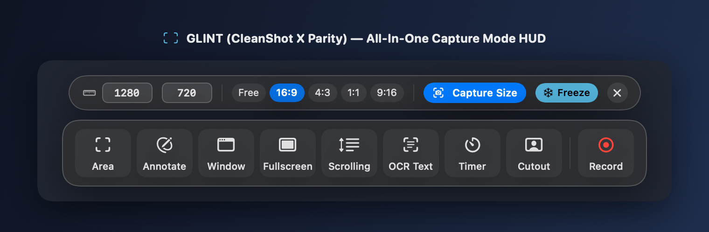
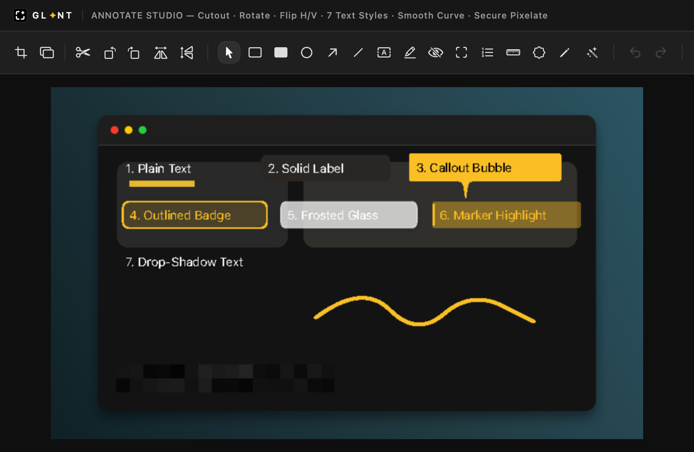
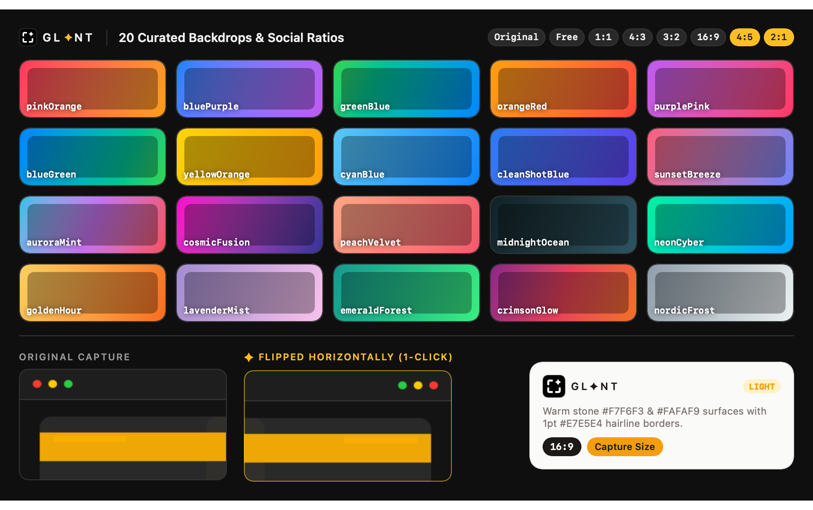
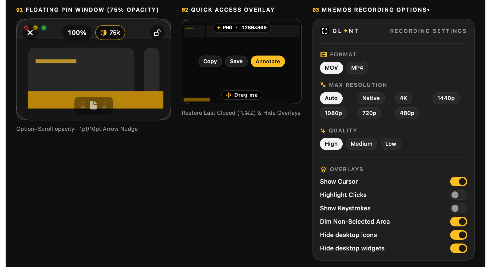
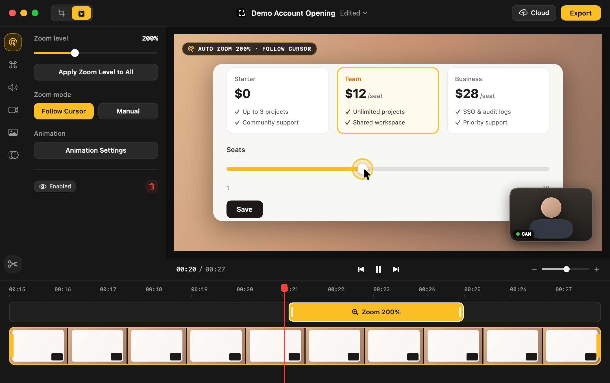

# GLINT for macOS — Public Iteration Releases

> 🔒 **Source Code Privacy**: The GLINT source repository (`hungchen0715/GLINT`) is **Private**. This public repository distributes automated macOS iteration builds (`DMG` / `ZIP`) and visual verification snapshots on every iteration.

## 🚀 Latest Iteration: `v2.2.0-beta.9-iter.6`
- **Built At**: 2026-11-10 21:35 UTC
- **Commit**: `7c10fca5`
- **Direct Download (Always Latest)**:
  - 💿 [**Download GLINT-macOS.dmg (Latest)**](https://github.com/hungchen0715/GLINT-Releases/releases/download/latest/GLINT-macOS.dmg)
  - 📦 [**Download GLINT-macOS.app.zip (Latest)**](https://github.com/hungchen0715/GLINT-Releases/releases/download/latest/GLINT-macOS.app.zip)
  - 🏷️ [**View All Iteration Releases**](https://github.com/hungchen0715/GLINT-Releases/releases)

---

## 📸 Automated macOS Verification Screenshots (`v2.2.0-beta.9-iter.6`)

### 1. CleanShot X All-In-One Mode HUD

### 2. Annotate Editor, Flip H/V, 7 Predefined Text Styles, Smooth Pencil & Secure Pixelate

### 3. 20 CleanShot X Curated Gradient Presets & Social Aspect Ratios

### 4. Floating Pin Window Opacity Pill, Quick Access Card & Recording Options

### 5. Screen + Webcam Recording & Smart Zoom Multi-Track Video Editor Studio

